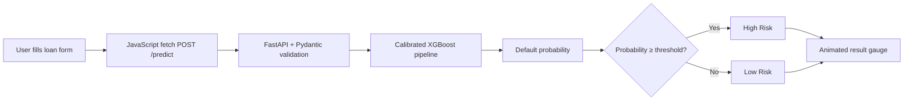

<div align="center">

# 🏦 Credit Risk Prediction System

**An end-to-end machine learning project that predicts the probability of loan default, served through a FastAPI backend and a modern animated web interface.**


[**🚀 Live Demo**](https://credit-risk-prediction-system-ijop.onrender.com) · [**📖 API Docs**](https://YOUR-APP-NAME.onrender.com/docs) · [**📓 Notebook**](Credit_risk.ipynb)

<!-- Add a screenshot or GIF of your UI here: -->
<!--  -->

</div>

---

## 📌 Overview

Lenders lose money when borrowers default, but rejecting good applicants costs them business too. This project estimates **how likely an applicant is to default** from their personal, credit-history and loan details, and returns a clear **High Risk / Low Risk** decision.

The project covers the full lifecycle: data cleaning, exploratory analysis, model comparison, hyperparameter tuning, probability calibration, explainability with SHAP, and production deployment as a web app.

## ✨ Features

- **Calibrated default probability** (Platt scaling), so the output behaves like a real probability and not an arbitrary score
- **REST API** built with FastAPI, with request validation through Pydantic and auto-generated Swagger docs
- **Interactive web UI** with an animated gauge, live loan-to-income calculation and input validation
- **Imbalance-aware training** (≈22% of loans are defaults) using class weighting and stratified splits
- **Explainability** with global and local SHAP analysis in the notebook
- **Single-service deployment**: one FastAPI app serves both the API and the frontend

## 🧰 Tech Stack

| Layer | Tools |
|---|---|
| **Machine Learning** | Python, pandas, NumPy, scikit-learn, XGBoost, SHAP |
| **Backend** | FastAPI, Uvicorn, Pydantic, joblib |
| **Frontend** | HTML5, CSS3, vanilla JavaScript |
| **Deployment** | Render |

## 🏗️ Architecture



## 🧠 Machine Learning Workflow

**Dataset:** 32,581 loan records, 12 features, with a binary target `loan_status` (1 = default, 0 = repaid).

| Step | What was done |
|---|---|
| **1. Data cleaning** | Removed duplicates and impossible values (age outside 18–100, employment length above 60 years or above age, non-positive loan amounts) |
| **2. EDA** | Class balance, distributions, box plots for outliers, correlation heatmap |
| **3. Preprocessing** | `ColumnTransformer` with median imputation for numeric columns and constant imputation plus one-hot encoding for categorical columns, all inside a scikit-learn `Pipeline` to prevent data leakage |
| **4. Class imbalance** | `scale_pos_weight` (≈3.63) for XGBoost, `class_weight="balanced"` for the other models |
| **5. Model comparison** | Logistic Regression (baseline), Random Forest, XGBoost, evaluated with 5-fold stratified cross-validation |
| **6. Tuning** | `RandomizedSearchCV` with 150 candidates × 5 folds, optimising average precision |
| **7. Calibration** | `CalibratedClassifierCV` with sigmoid (Platt) scaling |
| **8. Explainability** | SHAP summary plot (global) and waterfall plot (single applicant) |
| **9. Error analysis** | Reviewed false positives (213) and false negatives (273) on the test set |

### 📊 Results

Hold-out test set: 6,305 applicants (20% stratified split, `random_state=42`), default decision threshold of 0.5.

| Model | Accuracy | Precision | Recall | F1 |
|---|:---:|:---:|:---:|:---:|
| Logistic Regression (baseline) | 0.82 | 0.56 | 0.79 | 0.65 |
| Random Forest | 0.93 | 0.91 | 0.75 | 0.82 |
| XGBoost (default) | 0.92 | 0.82 | 0.79 | 0.81 |
| **XGBoost (tuned)** | **0.92** | **0.84** | **0.80** | **0.82** |

5-fold cross-validated ROC-AUC on the training set: **0.95** for XGBoost versus 0.87 for Logistic Regression.

**Why XGBoost?** It was a close call with Random Forest on F1. XGBoost was chosen for its balance of precision and recall (catching 80% of defaulters), its strong ROC-AUC, and its native support for class weighting and SHAP explanations. In credit risk, missing a real defaulter is usually costlier than a false alarm, so recall matters.

## 📁 Project Structure

```
credit-risk-prediction-system/
├── main.py                  # FastAPI app (API + serves the UI)
├── Credit_risk.ipynb        # Full analysis and model training notebook
├── Credit_Risk_Model.pkl    # Trained, calibrated XGBoost pipeline
├── Best_Threshold.pkl       # Decision threshold
├── credit_risk_dataset.csv  # Dataset
├── requirements.txt         # Python dependencies
├── .python-version          # Python version for Render
└── static/
    ├── index.html           # UI markup
    ├── style.css            # Styling and animations
    └── script.js            # Form logic, API calls, gauge animation
```

## 🚀 Run Locally

```bash
# 1. Clone the repository
git clone https://github.com/YOUR-USERNAME/credit-risk-prediction-system.git
cd credit-risk-prediction-system

# 2. Create and activate a virtual environment
python -m venv venv
source venv/bin/activate        # Windows: venv\Scripts\activate

# 3. Install dependencies
pip install -r requirements.txt

# 4. Start the server
uvicorn main:app --reload
```

Open **http://127.0.0.1:8000** for the app, or **http://127.0.0.1:8000/docs** for the interactive API documentation.

## 🔌 API Reference

### `POST /predict`

**Request body**

```json
{
  "person_age": 28,
  "person_income": 60000,
  "person_home_ownership": "RENT",
  "person_emp_length": 4,
  "loan_intent": "PERSONAL",
  "loan_grade": "B",
  "loan_amnt": 12000,
  "loan_int_rate": 11.5,
  "loan_percent_income": 0.2,
  "cb_person_default_on_file": "N",
  "cb_person_cred_hist_length": 5
}
```

**Response**

```json
{
  "default_probability": 0.0412,
  "default_prediction": 0,
  "threshold": 0.5,
  "Result": "Low Risk"
}
```

| Field | Allowed values |
|---|---|
| `person_home_ownership` | `RENT`, `OWN`, `MORTGAGE`, `OTHER` |
| `loan_intent` | `PERSONAL`, `EDUCATION`, `MEDICAL`, `VENTURE`, `HOMEIMPROVEMENT`, `DEBTCONSOLIDATION` |
| `loan_grade` | `A` to `G` |
| `cb_person_default_on_file` | `Y`, `N` |

### `GET /health`
Returns `{"status": "ok"}`. Used for health checks.

## ☁️ Deploy on Render

1. Push this repository to GitHub (including both `.pkl` files).
2. On [Render](https://render.com), create a **New → Web Service** and connect the repo.
3. Use these settings:

| Setting | Value |
|---|---|
| Runtime | Python 3 |
| Build command | `pip install -r requirements.txt` |
| Start command | `uvicorn main:app --host 0.0.0.0 --port $PORT` |
| Health check path | `/health` |

> The free tier sleeps after inactivity, so the first request may take 30–50 seconds.

## 🔭 Future Improvements

- Add Docker support and a CI/CD pipeline
- Show per-applicant SHAP explanations in the UI
- Add unit tests for the API and a model-monitoring dashboard
- Support batch predictions through CSV upload

## ⚠️ Disclaimer

This is a portfolio and educational project trained on a public dataset. It is **not** intended for real lending decisions.

## 👤 Author

**Rohit**

[](https://github.com/YOUR-USERNAME)
[](https://linkedin.com/in/YOUR-PROFILE)

---

<div align="center">⭐ If you found this project useful, consider giving it a star!</div>
